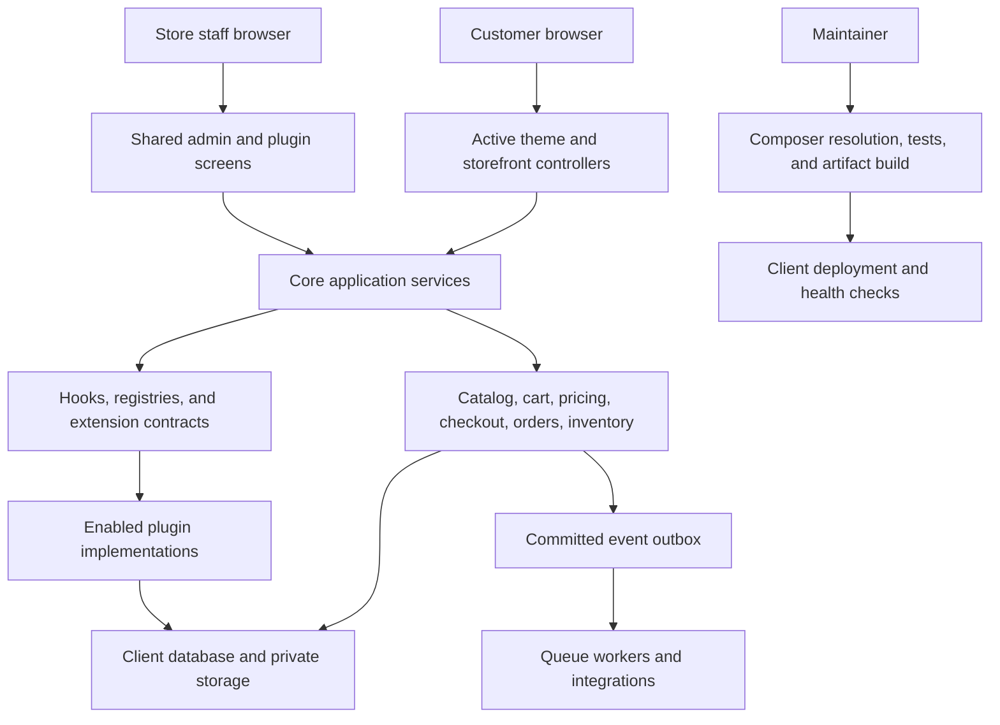

# Ecommerce Platform Architecture

Status: Proposed architecture for review  
Date: 2026-10-07  
Requirements: [Platform PRD](PRD.md)  
Implementation status: Incremental implementation. Independent core/contracts foundations are installed; persistence/admin adapters remain in the host. Initial plugin discovery/lifecycle/hooks/registries/settings are implemented; theme discovery/fallback/inheritance/settings/preview/activation and Happy Tea extraction are implemented; advanced DTO/slot APIs remain proposed. See [implemented theme runtime](THEME_RUNTIME.md). See [implemented plugin runtime](PLUGIN_RUNTIME.md). See [core package operations](CORE_PACKAGES.md) and [progress](progress.md).

## 1. Architecture decision

Build a Laravel modular monolith with a WordPress-like extension experience:

- One versioned commerce core and shared admin.
- Themes for storefront presentation, including optional child themes.
- Plugins for extending existing capabilities and adding complete new features.
- Actions, filters, typed provider registries, and UI extension slots.
- Explicit installation, activation, deactivation, updates, and removal.
- Independent client deployments, databases, configuration, and installed package versions.

Use Laravel's container, service providers, routes, Blade views, policies, migrations, events, queues, and localization. Use Composer for PHP packages and dependency resolution. Add the platform-specific extension manager and contracts around these existing mechanisms.

Core also owns central media management through `spatie/laravel-medialibrary`: its polymorphic file table, stable asset ownership, polymorphic reusable usage references, shared picker, private delivery, and registered conversion profiles. See [Central media management](MEDIA_MANAGEMENT.md). Merchant uploads are client data; packaged theme/plugin assets remain release artifacts.

The WordPress reference is the developer/admin experience. This platform does not promise compatibility with WordPress themes/plugins or adopt its database schema.

Package names beginning with `mavyn/` below are illustrative names, not a final product naming decision. All code snippets and commands are proposed interfaces, not currently available APIs.

## 2. What we borrow from WordPress

| Familiar concept | Proposed platform equivalent |
|---|---|
| Plugins screen | Installed plugins, versions, status, settings, dependency/compatibility messages |
| Activate/deactivate | Managed lifecycle transition with validation, audit, and runtime synchronization |
| Actions | Named events for reacting to completed operations |
| Filters | Named, typed transformations at documented extension points |
| Plugin-owned functionality | Namespaced routes, services, tables, settings, admin screens, assets, and jobs |
| Themes screen | Compatible installed themes, preview, configuration, activation |
| Child themes | One-level parent inheritance and supported template/style overrides |
| Theme customizer | Schema-driven branding/section configuration with authenticated preview |
| Updates | New-version visibility and approved deployment jobs with compatibility checks |

WordPress separates action callbacks from value-transforming filters and distinguishes deactivation from uninstall. These are useful foundations for the platform's API. See [WordPress hooks](https://developer.wordpress.org/plugins/hooks/) and [activation/deactivation lifecycle](https://developer.wordpress.org/plugins/plugin-basics/activation-deactivation-hooks/).

WordPress child themes preserve customizations separately from the parent. We adopt that purpose with our own template contracts; see [WordPress child themes](https://developer.wordpress.org/themes/advanced-topics/child-themes/).

## 3. System structure



Within core, organize catalog, customers, cart, pricing, checkout, orders, inventory, and platform infrastructure as modules with application services. Controllers validate/authorize requests and delegate to these services; they do not become the primary home of business rules.

Use Eloquent and the existing database model where appropriate. Avoid introducing a separate service or generic repository for every existing model. Public contracts expose intentional operations and DTOs, rather than making every internal class a promised extension API.

## 4. Package and repository layout

Start with a development monorepo to make extraction and contract changes manageable. Every distributable remains a versioned Composer package and can later move to its own repository.

```text
platform-workspace/
  apps/
    development-store/          Laravel host for development and integration tests
  packages/
    contracts/                 Public DTOs, interfaces, event/hook definitions
    core/                      Commerce modules, shared admin, extension manager
  plugins/
    local-delivery/
    manual-payments/
    food-products/
    store-availability/
  themes/
    default/
    happy-tea/
  tools/
    extension-scaffolding/     Developer commands and sample extension fixtures
  docs/
```

The production client host is thin:

```text
client-store/
  app/                         Minimal host wiring; no copied core modifications
  bootstrap/
  config/
  composer.json                Selected core, plugin, theme versions and repositories
  composer.lock                Exact resolved dependency graph for this client release
  vendor/                      Core, extensions, and their compatible dependencies
  public/extension-assets/     Built, versioned assets; no executable uploads
  storage/                     Client files, runtime data, logs
  .env                         Client configuration/secrets, outside release artifacts
```

Laravel/framework and host runtime updates are also versioned deployment changes. A thin host still needs a maintained host template/bootstrap upgrade path; core package updates alone do not guarantee every framework-level change is applied.

During extraction, move existing classes incrementally into the core package. Preserve compatible routes and data while introducing application services and tests. Do not reorganize the entire repository before validating the first extension.

## 5. Plugin dependencies and `vendor/`

### Recommended default

Each plugin owns:

- Its `composer.json`, package identity, PSR-4 namespace, dependencies, and version.
- Its source, routes, views, translations, migrations, assets, and tests.
- A development/test host or workbench where it can install its own local `vendor/`.
- Optional frontend `package.json` and lockfile for building its own assets.

Each deployed client has one Composer dependency graph, one production `composer.lock`, and one root `vendor/`. Composer resolves core, plugins, and shared libraries together. This is standard package management behavior; see [Composer basic usage](https://getcomposer.org/doc/01-basic-usage.md).

Independent plugin ownership does not require independent production autoloaders. A plugin's internal development lockfile does not dictate dependency versions when installed as a package in a client host.

### Why independent production vendor folders are not the default

PHP classes share the process's class namespace. Loading two plugin autoloaders containing different versions of the same class does not establish isolation. Autoloader order can make one version win unexpectedly; globals and helper functions can also collide.

Resolve conflicts before shipping:

1. Prefer compatible version constraints and an adapter around a stable library API.
2. Reject an incompatible package combination during the client build.
3. For an unavoidable standalone library, evaluate build-time namespace prefixing with tests and a dependency inventory. This is an advanced exception, not automatic isolation of Laravel/framework packages.
4. For truly incompatible runtimes, use an external process/service with an explicit protocol and operational cost.

An installed but disabled plugin still participates in Composer resolution. Disabling it does not free its dependency constraints; removing/upgrading its package through a build does.

Use Composer path repositories for local monorepo development and private Composer/VCS distribution for releases. Repository configuration is owned by the root client/build project; dependency packages cannot be relied on to add recursive repositories. See [Composer repositories](https://getcomposer.org/doc/05-repositories.md).

## 6. Plugin package contract

Use one source of truth for metadata: the plugin's `composer.json` with platform metadata under `extra`. Generate an installed extension catalog during artifact build; never scan and execute arbitrary writable directories per request.

```json
{
  "name": "acme/local-delivery",
  "type": "library",
  "require": {
    "php": "^8.3",
    "mavyn/contracts": "^1.0",
    "mavyn/core": "^1.0"
  },
  "autoload": {
    "psr-4": {
      "Acme\\LocalDelivery\\": "src/"
    }
  },
  "extra": {
    "mavyn": {
      "kind": "plugin",
      "id": "acme.local-delivery",
      "name": "Local Delivery",
      "provider": "Acme\\LocalDelivery\\LocalDeliveryProvider",
      "requires_active": [],
      "conflicts_with": [],
      "capabilities": ["fulfillment.provider"]
    }
  }
}
```

The PHP/core constraints are examples and must be checked against the selected release runtime. The installed version comes from Composer's resolved package metadata; do not duplicate a manually maintained version in several manifests.

```text
local-delivery/
  composer.json
  src/
    LocalDeliveryProvider.php
    Providers/ZoneDeliveryProvider.php
    Http/Controllers/
    Models/DeliveryZone.php
    Jobs/
  database/migrations/
  routes/admin.php
  routes/storefront.php
  resources/views/
  resources/lang/
  resources/js/
  resources/css/
  tests/
```

Developers use a scaffold command to create this structure plus a provider and sample contract tests. A minimal plugin should need a manifest and provider, not a custom installer or manual edits to core bootstrap files.

## 7. Discovery, boot, and cached routes

Laravel service providers already support package integration and namespaced resources. We build on that mechanism; see [Laravel package development](https://laravel.com/framework/docs/13.x/packages).

Platform plugin providers are explicitly loaded by the extension manager, rather than indiscriminately auto-discovered as active features. They omit Laravel discovery entries; dependencies with auto-discovered providers must be reviewed and disabled through host discovery configuration when they have unwanted side effects. Package discovery alone cannot enforce plugin activation.

Boot sequence:

1. Load Composer autoloader, platform contracts, and core providers.
2. Read the immutable installed package catalog produced by the build.
3. Load the current client extension state and revision from a controlled cache/database source.
4. Validate compatibility and active dependencies; determine deterministic dependency order.
5. Register inert route definitions for installed plugins and active bindings/hooks/settings/UI contributions for enabled plugins.
6. Boot enabled implementations after their dependencies.
7. Resolve the active theme and its resources.

Split plugin integration into two phases:

- **Installed resources:** route declarations, metadata, migration inventory. Registering a route cannot execute plugin business code.
- **Enabled behavior:** provider implementations, callbacks, menus, scheduled work, and active settings/forms.

Cache routes for the installed package set, not the changing enabled set. Plugin routes use class controllers, namespaced names, activation guards, and relevant permissions. Disabled routes return an appropriate unavailable response before business execution; controllers and dependency constructors remain side-effect-free. A recorded route may exist while the corresponding feature is unreachable.

This prevents an admin activation toggle from requiring an immediate route-cache rebuild. Physical package install/remove still rebuilds routes and the extension catalog during deployment. Protect plugin API/webhook routes too; handle pending transactions before disabling their provider.

Avoid request-specific objects in process-wide singletons. Begin with conventional PHP request lifetimes; long-lived web workers require an explicitly tested extension-state refresh/restart strategy.

## 8. Extending existing behavior

Provide four deliberate mechanisms rather than permitting arbitrary replacement of any core class.

| Mechanism | Use | Guardrail |
|---|---|---|
| Actions/domain events | Send a notification or synchronize another system after an order is placed | Immutable payload; documented transaction timing; idempotent listeners |
| Filters | Change labels or presentation data at a defined point | Typed input/output, deterministic priority, final output validation |
| Typed registries/pipelines | Add payments, shipping, checkout rules, pricing contributions, attributes, workflows | Core retains orchestration, authorization, arithmetic, and invariants |
| UI slots | Add product fields, admin pages, account sections, theme blocks | Namespaced contribution, permission checks, validated save handler |

Illustrative provider registration:

```php
public function register(PluginContext $plugin): void
{
    $plugin->fulfillment()->add('acme.local-delivery.zone', ZoneDeliveryProvider::class);
    $plugin->admin()->page('delivery-zones', DeliveryZonesPage::class)
        ->requiresPermission('acme.local-delivery.manage');
    $plugin->actions()->listen(OrderPlaced::class, NotifyDispatcher::class);
    $plugin->filters()->add('catalog.product.display', AddDeliveryNotice::class, priority: 20);
}
```

The `PluginContext` derives identity/namespace from the validated manifest. Contributions carry stable IDs; order equal-priority callbacks by dependency order, plugin ID, and contribution ID. Duplicate registry keys, invalid payloads, cycles, and contradictory exclusive providers fail clearly.

Every public hook documents payload type/version, permitted changes, execution phase, failure policy, and whether it runs synchronously or asynchronously. Add custom hooks through the same registry so plugins can expose their own namespaced extension points.

### Financial and authorization boundaries

Do not offer an unrestricted `checkout.total` filter that can overwrite committed totals. Provide typed adjustments/fees with stable source identifiers and explicit applicability; the core validates currency, bounds, rounding, and the final total. Checkout validates current selections again inside the transaction.

Checkout validation plugins can reject an operation with a structured reason. Optional display filters cannot waive stock checks, ownership, or permissions. Required provider/validation errors block the operation; optional presentation failures may omit their contribution and record an error according to the hook contract.

Trusted PHP plugins technically have broad application access. These are supported development rules, enforced through review/tests where possible, not a claim of a sandbox.

## 9. Adding an entirely new feature

A plugin such as a loyalty system can own its tables, model/services, admin pages, account endpoints, permissions, settings, and event listeners. It calls core contracts to inspect orders or request an approved discount contribution.

Example flow:

1. Register `acme.loyalty.manage`, settings, and an admin/account UI contribution.
2. Install its namespaced tables through deployment migrations.
3. Listen to a completed-and-eligible order event and record earned points idempotently.
4. Provide a redemption rule/adjustment through the pricing contract, not a direct overwrite of order totals.
5. Reverse or compensate points through documented cancellation/refund events.
6. Disable new earning/redemption while preserving the historical ledger and pending operations.

No core file should require a special `if (loyaltyPlugin)` branch. If a feature needs a missing operation, add a generic contract to core, version it, and test it with more than one use case.

## 10. Lifecycle and plugin management

### States

Package presence/version belongs to the immutable build catalog. Client lifecycle state belongs in the database: inactive, activating, active, deactivating, blocked, or failed. Store desired state, applied state, generation, errors, and audit records so interrupted transitions are recoverable.

Admin shows Installed/Active/Inactive/Blocked/Update available, author, version, dependencies, capabilities, configuration link, and actionable error messages. Keep package approval/install permission separate from feature activation permission.

### Installation and update

Package installation/update happens in a build/deployment job. The admin can eventually request an approved job and display progress; it does not execute Composer in a customer request. MVP supports deployment-driven install/update, consistent with the PRD's trusted-package scope.

Sequence: resolve dependency graph → validate manifests/runtime → test → build assets/catalog → stage artifact → run migration/recovery preflight → deploy/migrate → rebuild caches → restart workers → health/commerce checks → record outcome.

### Activation

Acquire a client lifecycle lock; validate dependencies/configuration/required schema; run idempotent activation setup; publish a new state revision; refresh registries and synchronize workers; record completion. New behavior is exposed only once the transition is safely applied. Activation must not run schema migrations in the HTTP request.

Plugins that require another enabled plugin declare an active dependency in addition to the Composer package requirement. Installed does not mean enabled.

### Deactivation

Block deactivation when dependent plugins, active theme requirements, open payment transactions, reservations, or queued work make it unsafe. Offer the specific prerequisite/action rather than silently disabling dependents. Quiesce new work, drain or explicitly cancel compatible queued work, apply an idempotent deactivation hook, publish the state revision, and synchronize workers.

External webhook handling must remain available until outstanding provider transactions are settled or migrated. A callback exception requires an explicit supported draining mode; do not declare a provider fully disabled while quietly processing its new work.

### Removal and data cleanup

Remove package code only through a deployment after deactivation and pending-work checks. Retain data by default. Optional destructive cleanup is a separately authorized operation while the package cleanup handler remains installed; removal is not an automatic migration rollback.

If activation/provider boot fails, retain an error state and provide a platform CLI recovery command that excludes nonessential plugins. Fatal PHP errors may require reverting the artifact; recovery must not depend solely on the failing admin UI.

## 11. Migrations, plugin storage, and settings

- Plugins own tables prefixed/namespaced by their identity or a validated short namespace. Domain-specific fields belong in extension tables or a typed generic attribute system.
- Changes to core tables go through maintained core migrations/contracts, not unilateral plugin schema patches.
- Deployment tracks migration identifier, owning package, version/checksum, and application status. Never edit a migration already shipped to clients.
- Installed package migrations run through an explicit deployment plan, including inactive packages when required to make later activation safe. There is no request-time schema installation.
- Updates preserve data by default; downgrades require a tested compatible schema path or recovery plan.
- A plugin-specific settings namespace has types, defaults, validation, permissions, and secret markers.
- Admin form validation and persistence share schemas; arbitrary submitted settings keys are rejected.
- Product field contributions use a documented load/validate/save lifecycle and the enclosing transaction for required writes.

Suggested platform tables: `platform_plugins`, `platform_themes`, `platform_settings`, `platform_operations`, `platform_audit_logs`, `platform_outbox`, and a migration-ownership ledger. Exact schema design is a next implementation task, not a commitment to these names.

## 12. Theme architecture and child themes

Themes are Composer packages with platform metadata: ID, name, supported contracts/core versions, optional parent package, required active plugins, configuration schema, template inventory, and asset manifest.

```text
theme-default/
  composer.json
  resources/views/
    layouts/storefront.blade.php
    pages/home.blade.php
    catalog/product.blade.php
    cart/index.blade.php
    checkout/index.blade.php
    account/
    content/
  resources/lang/
  resources/css/
  resources/js/
  schemas/settings.json
  dist/manifest.json
```

Resolve each documented storefront template in this order:

1. Active child theme, if configured.
2. Its single declared parent, or the active standalone theme.
3. Core default storefront fallback.

Validate template identifiers, forbid path traversal, and reject parent cycles or multiple-level inheritance in MVP. Parent package versions are pinned through Composer. Child themes override templates/styles/labels and configuration defaults; they do not replace commerce services.

Plugin UI uses named slots and namespaced component contracts. A theme may supply an override for a documented plugin component, otherwise the plugin's own component renders. Avoid unrestricted filesystem override searches.

Core prepares page DTOs and secure route/actions for themes. Shared product configuration and checkout contracts remain available regardless of presentation. Store content/settings live in the database, never in a mutable theme source file.

Preview uses an authorized short-lived preview context and draft settings without changing the globally active theme. It does not change commerce state. Theme activation validates required pages/plugins, configuration, assets, and contract versions. Active preview/activation does not alter shared admin templates.

Build theme/plugin frontend dependencies in their own workspace, ship prebuilt versioned assets, and use a small documented shared UI runtime where necessary. Prevent duplicate global Alpine runtimes or CSS resets from conflicting; use scoped styles and namespaced events. Separate frontend bundles do not automatically isolate browser globals.

## 13. Orders, transactions, queues, and extension events

The core checkout service owns validation, idempotency, currency/rounding, stock commitments, coupon use, and order snapshots. Payment/fulfillment plugins implement typed contracts and return validated results.

For external online payments, record a durable attempt and idempotency key before the network operation, use a provider state machine, and finalize from confirmed results/callbacks. A database rollback cannot undo an external charge. Manual payment providers have simpler explicit pending/verified states.

Write order changes and an outbox event in the same database transaction. A dispatcher publishes committed events to queues with retry. Consumers deduplicate by event ID; outbox delivery is at least once, not exactly once. This avoids losing notifications/integrations when the database commits but queue publication fails.

Job envelopes identify plugin, payload version, store, idempotency key, and lifecycle generation. Retain compatible handler code until pending jobs are drained; do not delete a package while serialized jobs still require its classes. Record failures and provide replay/compensation procedures.

Historical order snapshots contain provider IDs/labels, product/variant/options, currency, totals, and permitted extension details. Reading old orders does not require every original plugin to remain enabled.

## 14. Compatibility and releases

Version contracts, core, plugins, and themes independently. Public contracts include DTO shape, hook payloads/timing, provider interfaces, UI slots, template contracts, settings schemas, and migration rules. Internal class names are not automatically stable APIs.

Two gates apply:

- **Build gate:** Composer checks package/runtime constraints across installed packages; platform checks manifests, conflicts, namespaces, and asset contracts.
- **Activation gate:** Platform checks enabled dependencies, active theme requirements, configuration, schema readiness, and pending business operations.

Breaking contract changes require a major version and a documented upgrade path. Deprecations include a supported replacement and release window. Client builds pin exact resolved versions; a central core release is deployed through each client's tested package graph, not copied into arbitrary existing vendor directories.

Use immutable release artifacts and persistent client data/configuration. Updates stage/canary before wider rollout. Record artifact/core/extension versions and migration results. Schema-safe code rollback differs from database restoration; recovery must account for transactions received after a backup.

## 15. Development workflow and test strategy

Provide documented proposed commands such as `platform:plugin:make`, `platform:theme:make`, `platform:extensions:validate`, `platform:plugins:activate`, and `platform:plugins:disable`. Commands and admin operations call the same lifecycle services.

Developer loop:

1. Scaffold an extension into the development workspace.
2. Add its Composer package through a path repository.
3. Implement its provider/contracts and owned resources.
4. Test independently in a host fixture and in the integration store.
5. Build its frontend assets and publish a versioned package.
6. Resolve/test selected client combinations and deploy an immutable artifact.

Required test groups:

- Existing commerce/auth regression tests adapted during extraction.
- Contract tests for provider implementations, typed filters, and payload validation.
- Lifecycle tests for dependencies, cycles, concurrent transitions, failures, and recovery.
- Cached-route tests proving disabled endpoints cannot execute functionality.
- Isolation tests across two client deployments/namespaces.
- Upgrade fixtures for migrations, old orders, pending jobs, and plugin disable/removal.
- Concurrent/idempotent checkout, inventory, coupon, and external-callback tests.
- Default/child-theme required-page tests and accessibility checks for primary journeys.
- A non-food pilot and a shared core update across both pilots without core forks.

## 16. Implementation sequence

1. Establish correctness regression checks and fix the critical existing access/checkout defects.
2. Extract a small contracts package and core application services with current UI preserved.
3. Build extension metadata/catalog, lifecycle state, registry, guarded routes, and schema-driven settings.
4. Extract local delivery as the first plugin to prove a real admin/checkout extension end to end.
5. Extract manual payments and food/availability behavior; verify active dependencies and historical snapshots.
6. Introduce theme resolver/default fallback and move the existing storefront into Happy Tea; prove a small child theme override.
7. Build a non-food store and a genuinely new feature fixture to test extensibility beyond extracted code.
8. Finish permission/audit coverage, deployment compatibility gates, outbox/worker handling, and recovery drills.
9. Rehearse migration and shared updates before production rollout.

Do not start with a marketplace, microservices, a custom dependency resolver, or separate production vendor folders. The first architecture milestone is one real plugin, one theme, and a demonstrated update path with no core edits per client.

## 17. Decisions and remaining design work

### Proposed decisions

| Decision | Choice |
|---|---|
| Application model | Laravel modular monolith |
| Client isolation | Separate deployments/databases initially |
| Distribution | Composer packages, versioned artifacts, per-client lockfile |
| Plugin dependencies | Independent declarations; one resolved production vendor |
| Plugin integration | Managed providers, typed registries, actions, filters, UI slots |
| Theme rendering | Blade, documented DTO/actions, one-level child theme support |
| Discovery | Build-generated installed catalog; controlled runtime activation |
| Routes | Installed routes cached, disabled behavior guarded |
| Migrations | Deployment-controlled; no HTTP activation migrations |
| Event durability | Transactional outbox and idempotent consumers |
| Media management | Core Spatie adapter, polymorphic asset/usage associations, shared picker, private storage, queued profiles |
| Installation authority | Trusted packages via build/deployment; admin activation of approved packages |

### Resolve before implementation of each area

- Final package/product names and tested runtime/hosting versions.
- Public contract signatures and first hook catalog, including exact pricing-adjustment rules.
- Plugin transition locking, worker coordination, draining, and recovery details.
- Permissions/roles and approved-package distribution/deployment provider.
- Variant inventory/reservation and supported regional tax rules.
- Theme DTO/template inventory and shared frontend runtime contract.
- Outbox/job retention, operational monitoring, backup and recovery objectives.

These choices refine the architecture; they do not require changing the basic plugin dependency model or copying client-specific logic back into core.
